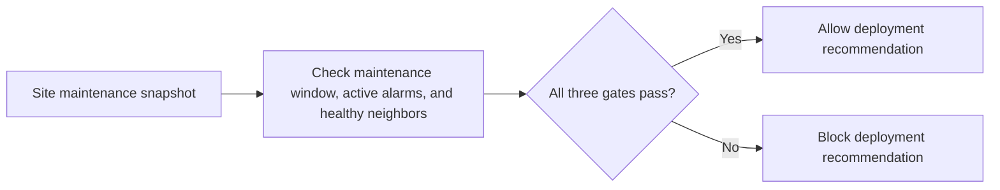

# Cell Site Deploy Gate architecture

Blocks site deployments when maintenance windows, alarms, or neighbor-cell health are unsafe.

## Operational boundaries

The documented run evaluates the bundled sample locally. Results depend on the quality and scope of the input. The demo makes no live infrastructure changes.
